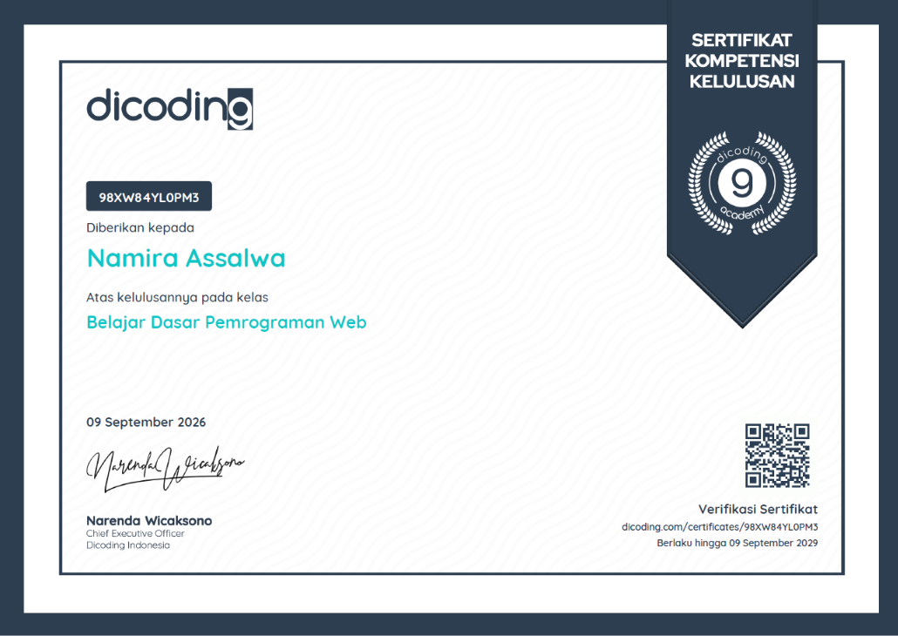

# Dev Learning Journal 🚀

A personal web development and technology learning journal created to document daily notes and articles. Built with semantic HTML5 and responsive CSS Flexbox.

> 📜 **Certification Context:** This project was developed as the final submission for the **Fundamentals of Web Programming** class in the **Dicoding DBS** program.  
> [](Fundamentals-of-Web-Programming.pdf)

## 🛠️ Built With

*   **HTML5** (Semantic elements: `<header>`, `<nav>`, `<main>`, `<article>`, `<aside>`, `<footer>`)
*   **CSS3** (Flexbox layout, CSS variables, responsive design with Media Queries)

## 📂 Project Structure

```text
dev-learning-journal/
│
├── index.html                 # Main HTML file containing the structure and content
├── style.css                  # Stylesheet for layout, typography, and theme
└── assets/
    └── pasFotoMerah.jpeg      # Profile image

```

## 🌟 Features

* **Semantic Layout:** Designed using clean and modern HTML5 semantic tags for better accessibility and SEO.
* **Responsive Design:** Fully responsive layout with custom media queries to ensure smooth viewing across desktop, tablet, and mobile devices.
* **Profile Section:** Includes a dedicated sidebar card containing a brief bio and author profile picture.
* **External Links:** Direct integration with Dicoding profile and learning resources.

